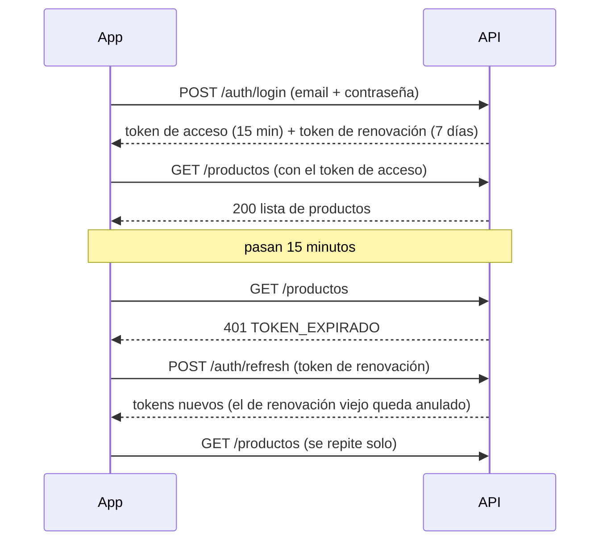

# Cómo está hecho BurgosCorp ERP

Este documento explica **qué se hizo, cómo funciona y en qué archivo está cada cosa**, en
lenguaje simple. Sirve para entender el proyecto, para estudiarlo antes de la defensa y para
encontrar rápido el código de cada parte.

> Se actualiza al terminar cada día del plan. Última actualización: **día 5**.

---

## 1. La idea en dos párrafos

BurgosCorp S.A. es un taller industrial ficticio que repara, diseña y fabrica piezas con
impresión 3D, tornos, CNC, soldadura y herrería. El sistema es un **ERP al estilo SAP R/3**:
una sola aplicación con módulos para cada área de la empresa (Recursos Humanos, Ventas,
Producción, Inventario, Compras, Mantenimiento, Calidad y Finanzas) que comparten la misma base
de datos.

El centro del sistema son las **tareas**: un trabajo de un cliente se convierte en una orden de
trabajo, que se divide en operaciones (diseñar, tornear, soldar…), y cada operación se asigna a
un empleado con la habilidad necesaria y a una máquina disponible.

## 2. Las tres piezas

```
┌──────────────────────┐        HTTPS + JSON         ┌──────────────────────┐        SQL        ┌──────────────┐
│  App móvil           │  ─────────────────────────▶ │  API REST            │ ────────────────▶ │  MySQL       │
│  React Native (Expo) │  ◀───────────────────────── │  Node.js + Express   │ ◀──────────────── │  51 tablas   │
│  carpeta mobile/     │   token en "Authorization"  │  carpeta backend/    │                   │  backend/db/ │
└──────────────────────┘                             └──────────────────────┘                   └──────────────┘
```

| Pieza | Qué hace | Dónde está |
|---|---|---|
| App | Pantallas que usa el empleado en el celular | [`mobile/`](../mobile) |
| API | Recibe pedidos de la app, controla permisos y habla con la base | [`backend/`](../backend) |
| Base de datos | Guarda todo: usuarios, empleados, máquinas, stock… | [`backend/db/schema.sql`](../backend/db/schema.sql) |

---

## 3. La base de datos

**Archivo:** [`backend/db/schema.sql`](../backend/db/schema.sql), con las tablas separadas por
módulo y comentadas. Los datos iniciales (roles, áreas, máquinas, productos) están en
[`backend/db/seed.sql`](../backend/db/seed.sql). Los datos de prueba (30 empleados y 29
usuarios) los carga [`backend/scripts/seed.js`](../backend/scripts/seed.js).

Ideas clave:

- **La base también controla.** Tiene reglas propias (`CHECK`) que rechazan datos imposibles
  aunque la API tuviera un error: stock negativo, licencias con la fecha de fin antes que la de
  inicio, una factura de venta a un proveedor, alícuotas de IVA que no existen.
- **Nada se borra de verdad.** Clientes, productos o máquinas se *desactivan* (`activo = 0`),
  así no se pierde la historia.
- **Lo sensible nunca se guarda en claro.** Las contraseñas, los tokens y los códigos se guardan
  como hash (una huella que no se puede revertir), igual que los códigos que se mandan por email.
- **Numeración tipo SAP.** La tabla `secuencias` genera números como `OT-2026-0001`.

| Módulo | Tablas principales |
|---|---|
| Seguridad | `usuarios`, `roles`, `permisos_rol`, `cuentas_sociales`, `refresh_tokens`, `codigos_verificacion`, `auditoria` |
| Organización | `areas`, `area_modulos`, `puestos` |
| RRHH | `empleados`, `habilidades`, `empleado_habilidades`, `asistencias`, `solicitudes_licencia`, `epp_entregas` |
| Ventas | `clientes`, `servicios`, `solicitudes`, `presupuestos`, `presupuesto_items` |
| Producción y Tareas | `centros_trabajo` (máquinas), `ordenes_trabajo`, `tareas`, `tarea_asignaciones`, `registros_horas`, `consumos_material` |
| Inventario y Compras | `productos`, `depositos`, `stock`, `movimientos_stock`, `reservas_material`, `proveedores`, `ordenes_compra`, `orden_compra_items` |
| Mantenimiento y Calidad | `planes_mantenimiento`, `ordenes_mantenimiento`, `inspecciones`, `inspeccion_mediciones` |
| Finanzas | `comprobantes`, `comprobante_items`, `pagos` |

---

## 4. La API (backend)

### 4.1 El recorrido de un pedido

Cuando la app pide, por ejemplo, la lista de máquinas (`GET /api/v1/centros-trabajo`), el pedido
pasa por una serie de "filtros" (middlewares) en orden. Si alguno falla, el pedido se corta ahí
y se responde con un error claro.

| # | Paso | Qué controla | Archivo |
|---|---|---|---|
| 1 | Cabeceras de seguridad | Agrega protecciones estándar a cada respuesta | [`middlewares/seguridad.js`](../backend/src/middlewares/seguridad.js) |
| 2 | CORS | Solo acepta navegadores de orígenes conocidos | mismo archivo |
| 3 | Límite de pedidos | Frena a quien manda demasiados pedidos seguidos | [`middlewares/limites.js`](../backend/src/middlewares/limites.js) |
| 4 | Formato | El cuerpo tiene que ser JSON y pesar menos de 100 KB | [`app.js`](../backend/src/app.js) |
| 5 | ¿Quién sos? | Lee el token y carga el usuario desde la base | [`middlewares/auth.js`](../backend/src/middlewares/auth.js) |
| 6 | ¿Email verificado? | Sin verificar, no se entra a los módulos | mismo archivo |
| 7 | ¿Tenés permiso? | Rol, módulo, acción y área | [`middlewares/permisos.js`](../backend/src/middlewares/permisos.js) |
| 8 | ¿Los datos son válidos? | Tipos, largos y formatos de cada campo | [`middlewares/validar.js`](../backend/src/middlewares/validar.js) |
| 9 | Trabajo real | Consulta la base filtrando por tu alcance | [`utils/crud.js`](../backend/src/utils/crud.js) |
| 10 | Errores | Convierte cualquier error en un mensaje claro | [`middlewares/errores.js`](../backend/src/middlewares/errores.js) |

El servidor arranca en [`src/server.js`](../backend/src/server.js) y las rutas se juntan en
[`src/routes/index.js`](../backend/src/routes/index.js).

### 4.2 Iniciar sesión y mantenerla

**Archivos:** [`services/auth.js`](../backend/src/services/auth.js) (registro y login),
[`services/tokens.js`](../backend/src/services/tokens.js) (tokens),
[`routes/auth.js`](../backend/src/routes/auth.js) (endpoints).

Se usan **dos tokens**, como una pulsera y un ticket:

- **Token de acceso** (la pulsera): dura **15 minutos** y viaja en cada pedido. Si alguien lo
  roba, le sirve muy poco tiempo.
- **Token de renovación** (el ticket): dura **7 días** y sirve solo para conseguir una pulsera
  nueva. **Cada vez que se usa, se cambia por otro.** Si alguien intenta usar un ticket viejo
  (señal de que lo robaron), se cancelan todas las sesiones de ese dispositivo.



Otras protecciones del login:

- Las contraseñas se guardan con **bcrypt**, un hash lento a propósito para que adivinarlas sea
  muy caro.
- Después de **5 intentos fallidos**, la cuenta se bloquea 15 minutos.
- Si el email no existe, la respuesta es la misma que con una contraseña incorrecta, para no
  revelar quién tiene cuenta.

### 4.3 Otras formas de verificar (requisito de la consigna)

| Qué | Cómo funciona | Archivo |
|---|---|---|
| **Solicitud de acceso** | Como en el portal R3: quien se registra (o entra por primera vez con una red social) queda pendiente y no puede iniciar sesión hasta que un administrador lo habilita con su rol y legajo, o lo rechaza. En los dos casos le llega un email | [`services/auth.js`](../backend/src/services/auth.js), [`routes/usuarios.js`](../backend/src/routes/usuarios.js), [`modulos/usuarios/solicitudes.js`](../mobile/src/app/(app)/modulos/usuarios/solicitudes.js) |
| **Verificar email** | La primera vez que entra, le llega un código de 6 dígitos; hasta confirmarlo solo se puede usar la parte de login | [`services/verificacion.js`](../backend/src/services/verificacion.js) |
| **Recuperar contraseña** | Se pide un código por email y con él se define una contraseña nueva | mismo archivo |
| **Verificación en dos pasos (2FA)** | Además de la contraseña, un código de 6 dígitos que llega al email en cada ingreso | [`services/dosPasos.js`](../backend/src/services/dosPasos.js) |
| Códigos de un solo uso | Vencen en 10 minutos, admiten 5 intentos, se guardan como hash | [`services/codigos.js`](../backend/src/services/codigos.js) |
| Envío de correos | En desarrollo se muestran en la consola; en producción salen por SMTP | [`services/email.js`](../backend/src/services/email.js) |

**Cómo funciona la verificación en dos pasos:** para activarla, la persona pide un código y lo
escribe (así se comprueba que el email le llega). Desde ahí, cuando pone bien la contraseña, la API
no entrega la sesión: manda un código nuevo al email y devuelve un token temporal de 5 minutos que
no sirve para nada más. La sesión se entrega recién con el código correcto. Tres errores invalidan
el token temporal y los fallos cuentan para el bloqueo de la cuenta.

### 4.4 Login con Google, GitHub y Facebook

**Archivo:** [`services/social.js`](../backend/src/services/social.js). La guía para crear las
apps en cada proveedor está en [`docs/guia-oauth.md`](guia-oauth.md).

La app abre la pantalla de Google (o GitHub, o Facebook), el usuario acepta y la app le pasa a la
API lo que recibió. **La API no confía en eso:** lo verifica directamente con el proveedor.

- **Google:** comprueba la firma digital del token con las claves públicas de Google, y que el
  token sea para *esta* app y no haya vencido.
- **GitHub:** canjea el código con GitHub usando un secreto que solo conoce el servidor.
- **Facebook:** le pregunta a Facebook si el token es válido y si fue emitido para *esta* app.

Si el email de esa cuenta coincide con un empleado ya cargado, se vinculan: el empleado entra
con su Google y conserva su rol y su área.

> Estado: el código del servidor está hecho y probado con proveedores simulados. Falta crear las
> apps en cada proveedor y agregar los botones en la app.

### 4.5 Roles y permisos

**Archivos:** [`services/permisos.js`](../backend/src/services/permisos.js) (la lógica) y la
tabla `permisos_rol` en [`seed.sql`](../backend/db/seed.sql) (la matriz).

Hay 4 roles: **Administrador**, **Gerencia**, **Jefe de área** y **Empleado**. Cada permiso se
decide con tres preguntas:

1. **¿Qué rol tenés y qué querés hacer en qué módulo?** Por ejemplo, Empleado + crear + Inventario.
2. **¿Tu área administra ese módulo?** Algunos módulos son del área dueña: solo Abastecimiento
   carga productos y órdenes de compra, y solo Administración ve Finanzas.
3. **¿Sobre qué registros?** El **alcance**: `todo` (toda la empresa), `area` (tu área) o
   `propio` (solo lo tuyo).

Ejemplos reales, probados:

| Usuario | Ve | No ve |
|---|---|---|
| Jorge, jefe de Mecanizado | 18 máquinas de todas las áreas (su área administra Producción) | Ventas, Finanzas, Usuarios |
| Ramón, tornero | Solo las 7 máquinas de Mecanizado | Proveedores, Ventas, Finanzas |
| Ricardo, gerente | Todo | No puede modificar nada |

**Importante:** la app oculta los botones que no corresponden, pero **quien decide siempre es la
API**. Aunque alguien modificara la app, la API rechaza lo que no tiene permitido y lo registra en
la tabla `auditoria`.

### 4.6 El motor CRUD (lo que acelera el desarrollo)

**Archivo:** [`utils/crud.js`](../backend/src/utils/crud.js).

En vez de programar listar, ver, crear, editar y borrar para cada tabla, hay un "motor" al que se
le pasa una configuración y arma los 5 endpoints con paginación, búsqueda, filtros, orden,
permisos, alcance y auditoría. Por ejemplo, los clientes se configuran en
[`routes/catalogos.js`](../backend/src/routes/catalogos.js) en unas 10 líneas.

Por seguridad, los nombres de columnas, filtros y órdenes solo pueden ser los que dice la
configuración, y los valores que manda el usuario siempre van como parámetros. Eso hace
imposible la **inyección SQL**.

### 4.7 Recursos Humanos (día 5)

**Archivos:** [`routes/rrhh.js`](../backend/src/routes/rrhh.js) (endpoints),
[`services/licencias.js`](../backend/src/services/licencias.js),
[`services/asistencias.js`](../backend/src/services/asistencias.js),
[`services/notificaciones.js`](../backend/src/services/notificaciones.js) y
[`validators/rrhh.js`](../backend/src/validators/rrhh.js).

- **Legajos:** cada persona ve según su rol. Un empleado ve solo el suyo, un jefe los de su área
  y RRHH todos. Fuera de RRHH, lo único que se puede cambiar es el teléfono y la dirección
  propios. Así nadie puede subirse el sueldo o cambiarse de área. Los legajos no se borran: se
  dan de baja.
- **Habilidades:** cada empleado tiene sus habilidades con un nivel. Las que requieren
  certificación (soldadura MIG/TIG, trabajo en altura) guardan la fecha de vencimiento, y el
  sistema marca las vencidas. En el día 6 esto se usa para que **no se pueda asignar una tarea
  de soldadura a quien no está certificado**.
- **Fichaje:** botón de entrada y salida en Inicio. No se puede fichar dos veces la entrada, y
  RRHH puede corregir un olvido dejando el motivo registrado.
- **Licencias con circuito de aprobación**, igual que en SAP:

```
Empleado pide ──▶ Pendiente ──(jefe de su área)──▶ Aprobada por el jefe ──(RRHH)──▶ Aprobada
                      └──────────── Rechazada (con motivo) / Cancelada ─────────────┘
```

  Se cuentan solo los días hábiles, no se permiten pedidos superpuestos, nadie aprueba lo suyo y,
  si dos personas intentan resolver la misma solicitud a la vez, solo una lo logra.
- **Avisos:** cada paso le avisa a quien tiene que actuar ("Ramón pidió vacaciones", "Aprobaron
  tu solicitud").
- **Organigrama:** las áreas con su jefe y la cantidad de personas.

### 4.8 Producción y Tareas (día 6)

**Archivos:** [`routes/produccion.js`](../backend/src/routes/produccion.js) (endpoints),
[`services/ordenes.js`](../backend/src/services/ordenes.js) (órdenes de trabajo),
[`services/tareas.js`](../backend/src/services/tareas.js) (tareas, asignación y avance),
[`utils/secuencias.js`](../backend/src/utils/secuencias.js) (numeración) y
[`validators/produccion.js`](../backend/src/validators/produccion.js).

- **Orden de trabajo (OT):** es el pedido del cliente dentro del taller ("reparar el eje de una
  cosechadora"). Se numera sola (`OT-2026-0001`), sin saltos ni números repetidos aunque dos
  personas la creen a la vez. Tiene cliente, área, responsable, prioridad y fechas.
- **Operaciones:** cada OT se divide en pasos (10 diseño, 20 torneado, 30 soldadura…). Cada
  operación es una tarea y puede tener una máquina; si la tiene, queda en el área de esa máquina.
- **Estados de la OT:**

```
Planificada ──▶ En proceso ──▶ Control de calidad ──▶ Terminada ──▶ Entregada
     └────────── Pausada / Cancelada ──────────┘
```

  Pasa sola a "En proceso" cuando alguien empieza la primera operación, y a "Control de calidad"
  cuando todas están aprobadas. No se puede saltar pasos.
- **Asignar con reglas:** el jefe ve la lista de candidatos con su carga de trabajo. Solo aparecen
  quienes pueden hacerla: empleados activos, de esa área, con la habilidad que pide la máquina y,
  si hace falta certificación (soldadura MIG), con la certificación **vigente**. No se asigna
  trabajo a una máquina en mantenimiento.
- **Circuito de una tarea:**

```
Pendiente ──▶ En curso ⇄ Pausada ──▶ En revisión ──(jefe)──▶ Aprobada
                                          └──▶ Rechazada (con motivo) ──▶ vuelve a En curso
```

  Cada persona tiene una sola tarea en curso a la vez, no puede terminarla con la lista de control
  incompleta y nadie aprueba su propio trabajo. Las horas se miden solas entre iniciar y pausar o
  terminar, y se comparan con las estimadas.
- **Historial y comentarios:** cada cambio de estado queda registrado con quién y cuándo; cada
  paso avisa a quien tiene que actuar.

### 4.9 Inventario, Compras y Mantenimiento (día 7)

**Archivos:** [`services/stock.js`](../backend/src/services/stock.js) (todo movimiento de stock pasa por acá),
[`services/inventario.js`](../backend/src/services/inventario.js),
[`services/materiales.js`](../backend/src/services/materiales.js) (material de la OT),
[`services/compras.js`](../backend/src/services/compras.js),
[`services/mantenimiento.js`](../backend/src/services/mantenimiento.js),
[`services/escaneo.js`](../backend/src/services/escaneo.js) y sus rutas en
[`routes/inventario.js`](../backend/src/routes/inventario.js), [`routes/compras.js`](../backend/src/routes/compras.js)
y [`routes/mantenimiento.js`](../backend/src/routes/mantenimiento.js).

- **Stock disponible:** de cada producto se sabe cuánto **hay**, cuánto está **reservado** para
  órdenes de trabajo y cuánto queda **disponible** (lo que hay menos lo reservado). Cada entrada o
  salida queda en `movimientos_stock` con quién, cuándo y por qué documento (OC, OT u OM). Nunca
  queda negativo: la fila se bloquea mientras se descuenta.
- **¿Hay material para la OT?** El jefe reserva lo que necesita el trabajo. Si no alcanza, la
  reserva queda igual, se muestra cuánto falta y le llega el aviso a Abastecimiento. El operario,
  desde su tarea, registra lo que usa: baja del stock y el costo se suma al de la OT. Al entregar o
  cancelar la OT, lo que sobró de la reserva vuelve a estar disponible.

```
Jefe reserva ──▶ ¿alcanza? ── sí ──▶ queda apartado ──▶ operario usa ──▶ baja el stock y suma costo
                    └── no ──▶ aviso a Abastecimiento ──▶ orden de compra ──▶ llega ──▶ aviso al jefe
```

- **Orden de compra:** el comprador la arma (para stock o para una OT) y los importes con IVA los
  calcula el servidor. La aprueba **otra persona** (la jefa de Abastecimiento): quien pide no se
  aprueba a sí mismo. Al llegar la mercadería se recibe total o en partes, en el depósito elegido,
  con el número de remito y la foto del remito. El costo promedio del producto se recalcula.

```
Borrador ──▶ Para aprobar ──(jefa)──▶ Aprobada ──▶ Enviada ──▶ Recibida en parte ──▶ Recibida
                 └── Devolver a borrador (con motivo)
```

- **Falla de máquina:** cualquiera la reporta desde la ficha de la máquina (se llega escaneando su
  QR), con foto. Si "la máquina quedó parada", pasa a mantenimiento y Producción no puede asignarle
  ni iniciar operaciones. Un técnico la toma, carga los repuestos (salen del stock) y la cierra
  contando qué hizo; entonces la máquina vuelve a operar y se le avisa a quien la reportó.

```
Abierta ──▶ En reparación ⇄ Esperando repuesto ──▶ Reparada (con la solución)
   └──────── (jefe de Mantenimiento) ──▶ Cancelada
```

- **Preventivos:** cada máquina tiene planes ("lubricar guías cada 30 días"). El jefe de
  Mantenimiento ve los que vencen en la semana y genera la orden; al cerrarla, el plan se reprograma.
- **Códigos QR:** la app imprime etiquetas para la pieza (`BC:OT:OT-2026-0001`), la máquina
  (`BC:MAQ:CNC-02`), el estante (`BC:PRD:MP-1045-25`) y la orden de compra. Al escanear, la API dice
  qué es y si el usuario lo puede ver; al operario le abre directamente su operación en esa pieza.
  Lo leído nunca se abre como enlace.

### 4.10 Ventas, Calidad, Finanzas y Tablero (día 8)

**Archivos:** [`services/ventas.js`](../backend/src/services/ventas.js),
[`services/calidad.js`](../backend/src/services/calidad.js),
[`services/finanzas.js`](../backend/src/services/finanzas.js),
[`services/tablero.js`](../backend/src/services/tablero.js) y sus rutas en
[`routes/ventas.js`](../backend/src/routes/ventas.js), [`routes/calidad.js`](../backend/src/routes/calidad.js)
y [`routes/finanzas.js`](../backend/src/routes/finanzas.js).

El recorrido completo de un pedido, con el ejemplo de la reducción para la cosechadora (está
cargado en los datos de prueba):

```
Solicitud (con foto de la pieza) ──▶ Ingeniería la analiza ──▶ Presupuesto ──▶ enviado al cliente (WhatsApp)
     │                                                                              │
     └──────────────── cancelada / rechazada ◀──────────────────────────────── el cliente responde
                                                                                    │ acepta
OT creada sola: operaciones (horas de máquina) + material reservado ◀───────────────┘
     │
Producción ──▶ Calidad inspecciona ── no conforme ──▶ la operación se rehace ──┐
                     │ conforme                                               │
                     ▼                    ◀───────────────────────────────────┘
               OT terminada ──▶ Finanzas factura ──▶ cobro (total o en partes)
```

- **Solicitud:** Comercial carga lo que pide el cliente y le saca una foto a la pieza (o adjunta la
  que mandó). Se la asigna a Ingeniería, que arma el presupuesto. Desde la solicitud se llama o se
  escribe por WhatsApp al cliente con un toque.
- **Presupuesto:** cada línea es horas de máquina, material del stock u otro concepto. La app
  sugiere el precio (costo de la máquina o del material, con margen) y la API calcula subtotal,
  IVA y total. Ya enviado, se le manda al cliente un resumen por WhatsApp.
- **El cliente acepta:** el jefe elige el área y la API crea la OT sola: una operación por cada
  línea de máquina (con sus horas estimadas) y una reserva por cada material. Si falta material, a
  Abastecimiento le llega el aviso.
- **Calidad:** el inspector escanea la pieza (o la elige de la lista), carga las mediciones con su
  tolerancia y la app marca en rojo lo que queda afuera. Si algo no cumple, no se puede aprobar:
  se registra la **no conformidad**, se elige qué operación rehacer, al operario le llega el aviso
  y la OT vuelve a producción. Cuando se aprueba, la OT queda terminada y se avisa a Comercial y
  a Finanzas.
- **Finanzas:** factura la OT con las líneas del presupuesto (letra A o B según el cliente), carga
  la factura del proveedor de cada compra recibida (con su foto) y registra cobros y pagos, totales
  o parciales. Solo accede el área de Administración.
- **Tablero:** los números del día en tarjetas para el celular: OT abiertas y atrasadas, pedidos y
  presupuestos, calidad, máquinas paradas, stock y saldos. Cada rol ve solo lo de sus módulos.

### 4.11 Fotos y archivos adjuntos

**Archivos:** [`routes/adjuntos.js`](../backend/src/routes/adjuntos.js) y
[`services/adjuntos.js`](../backend/src/services/adjuntos.js). Sirve a todos los módulos: hoy se
usa en las tareas (foto del trabajo), las licencias (certificado médico), las órdenes de compra
(remito), las fallas de máquina, las solicitudes (la pieza del cliente), las inspecciones y las
facturas de proveedor.

- **Quién puede:** ve una foto quien puede ver la tarea o la licencia. La agrega quien trabaja en
  la tarea (o su jefe), o el empleado que pidió la licencia, y solo mientras no esté cerrada.
- **Qué se acepta:** fotos JPG, PNG o WebP y PDF, de hasta 8 MB y 12 por registro. El tipo se
  reconoce por el contenido del archivo, no por su nombre: un texto disfrazado de `.jpg` se rechaza.
- **Privacidad:** las fotos de los celulares traen datos ocultos (EXIF), como la ubicación GPS donde
  se sacaron. La app achica la foto antes de subirla (lado mayor de 1600 px, que además ahorra datos
  móviles) y el servidor igual borra esos datos.
- **Dónde se guardan:** en la carpeta `UPLOADS_DIR`, con un nombre aleatorio. El nombre original
  solo se muestra, nunca se usa para buscar el archivo en el disco.

### 4.12 Validación de datos

**Archivos:** [`validators/`](../backend/src/validators). Cada campo tiene reglas (tipo, largo
igual al de la base, formato). Por ejemplo, el CUIT se valida con su dígito verificador y se
rechazan los campos de más: nadie puede mandar `"rol": "ADMIN"` al registrarse.

---

## 5. La app (mobile)

### 5.1 Cómo está organizada

Con **Expo Router**, cada archivo dentro de [`mobile/src/app/`](../mobile/src/app) es una
pantalla, y la carpeta determina la ruta.

| Pantalla | Archivo |
|---|---|
| Login | [`(auth)/login.js`](../mobile/src/app/(auth)/login.js) |
| Registro | [`(auth)/registro.js`](../mobile/src/app/(auth)/registro.js) |
| Olvidé / nueva contraseña | [`(auth)/olvide.js`](../mobile/src/app/(auth)/olvide.js), [`(auth)/restablecer.js`](../mobile/src/app/(auth)/restablecer.js) |
| Segundo paso del login | [`dos-pasos.js`](../mobile/src/app/dos-pasos.js) |
| Confirmar email | [`verificar-email.js`](../mobile/src/app/verificar-email.js) |
| Inicio | [`(app)/index.js`](../mobile/src/app/(app)/index.js) |
| Módulos | [`(app)/modulos/`](../mobile/src/app/(app)/modulos) |
| Listado de cualquier recurso | [`(app)/modulos/[modulo]/[recurso].js`](../mobile/src/app/(app)/modulos/[modulo]/[recurso].js) |
| Perfil, 2FA y avisos | [`(app)/perfil/`](../mobile/src/app/(app)/perfil) |
| Mis licencias (pedir y cancelar) | [`(app)/modulos/rrhh/licencias.js`](../mobile/src/app/(app)/modulos/rrhh/licencias.js) |
| Aprobar licencias (jefes y RRHH) | [`(app)/modulos/rrhh/aprobaciones.js`](../mobile/src/app/(app)/modulos/rrhh/aprobaciones.js) |
| Legajo (datos, habilidades, contacto) | [`(app)/modulos/rrhh/legajo/[id].js`](../mobile/src/app/(app)/modulos/rrhh/legajo/[id].js) |
| Organigrama | [`(app)/modulos/rrhh/organigrama.js`](../mobile/src/app/(app)/modulos/rrhh/organigrama.js) |
| Tarjeta de fichaje (en Inicio) | [`componentes/Fichaje.js`](../mobile/src/componentes/Fichaje.js) |
| Órdenes de trabajo (lista, nueva, detalle con operaciones) | [`(app)/modulos/produccion/`](../mobile/src/app/(app)/modulos/produccion) |
| Mis tareas (pestaña: iniciar, pausar, terminar) | [`(app)/tareas/`](../mobile/src/app/(app)/tareas) |
| Tareas del área (jefes: asignar, aprobar, rechazar) | [`(app)/modulos/tareas/`](../mobile/src/app/(app)/modulos/tareas) |
| Detalle de una tarea (lista de control, horas, comentarios, historial) | [`componentes/DetalleTarea.js`](../mobile/src/componentes/DetalleTarea.js) |
| Selector con búsqueda (cliente, máquina, responsable) | [`componentes/Selector.js`](../mobile/src/componentes/Selector.js) |
| Fotos con la cámara o la galería (tareas, certificados, remitos, fallas) | [`componentes/Fotos.js`](../mobile/src/componentes/Fotos.js) |
| Escanear QR (ícono de la barra) | [`(app)/modulos/escanear.js`](../mobile/src/app/(app)/modulos/escanear.js), [`componentes/Escaner.js`](../mobile/src/componentes/Escaner.js) |
| Etiqueta QR para imprimir (pieza, máquina, estante, OC) | [`componentes/EtiquetaQR.js`](../mobile/src/componentes/EtiquetaQR.js) |
| Material de la OT (reservar, usar, liberar) | [`componentes/MaterialesOt.js`](../mobile/src/componentes/MaterialesOt.js) |
| Stock (lista y ficha con ajuste y transferencia) | [`(app)/modulos/inventario/`](../mobile/src/app/(app)/modulos/inventario) |
| Órdenes de compra (lista, nueva, detalle con aprobación y recepción) | [`(app)/modulos/compras/`](../mobile/src/app/(app)/modulos/compras) |
| Mantenimiento (fallas, reportar, detalle, ficha de la máquina) | [`(app)/modulos/mantenimiento/`](../mobile/src/app/(app)/modulos/mantenimiento) |
| Ventas (solicitudes con foto, presupuestos, aprobación que crea la OT) | [`(app)/modulos/ventas/`](../mobile/src/app/(app)/modulos/ventas) |
| Llamar o escribir por WhatsApp | [`componentes/Contacto.js`](../mobile/src/componentes/Contacto.js) |
| Calidad (para inspeccionar, inspección con mediciones, detalle) | [`(app)/modulos/calidad/`](../mobile/src/app/(app)/modulos/calidad) |
| Finanzas (saldos, por facturar, comprobantes, cobros y pagos) | [`(app)/modulos/finanzas/`](../mobile/src/app/(app)/modulos/finanzas) |
| Tablero | [`(app)/modulos/tablero.js`](../mobile/src/app/(app)/modulos/tablero.js) |

### 5.2 Qué pantalla se muestra (rutas protegidas)

**Archivo:** [`mobile/src/app/_layout.js`](../mobile/src/app/_layout.js). Según el estado de la
sesión, solo se puede ver un grupo de pantallas:

```
¿Hay sesión? ── no ──▶ ¿El login pidió el segundo paso? ── sí ──▶ Pantalla de 2FA
     │                                  └────────────── no ──▶ Login / Registro
     └── sí ──▶ ¿Email verificado? ── no ──▶ Confirmar email
                         └────────── sí ──▶ La app (pestañas)
```

### 5.3 Estado global y sesión que no se pierde

**Archivo:** [`mobile/src/contexto/sesion.js`](../mobile/src/contexto/sesion.js), con **Context
API + useReducer**, como pide la consigna. Guarda el usuario, sus permisos y el paso de 2FA
pendiente, y expone las acciones `login`, `registrar`, `completar2fa`, `logout`, etc.

- El token de renovación se guarda en **SecureStore**
  ([`lib/almacen.js`](../mobile/src/lib/almacen.js)), que en Android usa el almacén cifrado del
  sistema. Al abrir la app, la sesión se recupera sola.
- El cliente de la API ([`lib/api.js`](../mobile/src/lib/api.js)) agrega el token a cada pedido.
  Si el token venció, lo renueva y repite el pedido sin que el usuario se entere. También
  traduce cualquier error a un mensaje en castellano: sin conexión, tiempo agotado, sin permiso…

### 5.4 Identidad visual (igual al portal R3) y diseño adaptable

La app copia la identidad del portal BurgosCorp R3 (`C:\Estanga\React\R3 V`): la misma paleta,
el mismo logo, las mismas animaciones y la misma forma de avisar, sin alertas.

| Qué | Cómo | Archivo |
|---|---|---|
| Paleta | Los mismos tokens de R3: rojo `#c8102e` (`#ef3b4f` en oscuro), negro `#111` y grises zinc | [`tema.js`](../mobile/src/tema.js) |
| Logo | El escudo negro con borde rojo y "BC" en serif (`BrandLogo` / `ShieldSeal` de R3), dibujado con SVG; "Burgos**Corp**" en Georgia | [`componentes/Marca.js`](../mobile/src/componentes/Marca.js) |
| Intro de apertura | Pantalla negra con resplandor rojo, el escudo aparece y "BurgosCorp" se escribe letra por letra (una vez por apertura; se saltea tocando) | [`componentes/IntroSplash.js`](../mobile/src/componentes/IntroSplash.js) |
| Login | Panel de marca (en pantallas anchas) + formulario; "Recordar mi email"; el botón pasa a "Verificando credenciales…" y, si son válidas, el escudo se sella y aparece "Acceso verificado" | [`componentes/AuthLayout.js`](../mobile/src/componentes/AuthLayout.js), [`(auth)/login.js`](../mobile/src/app/(auth)/login.js) |
| Barra y pestañas | Negras en los dos modos; pestaña activa en blanco con línea roja; a la derecha, luna/sol y avatar | [`(app)/_layout.js`](../mobile/src/app/(app)/_layout.js) |
| Sin alertas | Los resultados se informan con **toasts** abajo (verde, rojo, amarillo o negro), las confirmaciones usan un **diálogo propio** y los errores de un campo aparecen debajo del campo | [`contexto/toast.js`](../mobile/src/contexto/toast.js), [`componentes/ConfirmDialog.js`](../mobile/src/componentes/ConfirmDialog.js) |
| Componentes | Botones y campos estilo Bootstrap, tarjetas con cabecera, insignias de rol (admin rojo suave, jefe negro, empleado gris), avatares con iniciales, esqueletos de carga, contadores animados, requisitos de contraseña que se tildan | [`componentes/ui.js`](../mobile/src/componentes/ui.js), [`lib/useContador.js`](../mobile/src/lib/useContador.js) |
| Modo claro / oscuro | Sistema, Claro u Oscuro en Perfil, o luna/sol en la barra y el login; queda guardado en el dispositivo (dato no sensible) | [`componentes/SelectorTema.js`](../mobile/src/componentes/SelectorTema.js), [`lib/preferencias.js`](../mobile/src/lib/preferencias.js) |

Con "reducir movimiento" activado en el sistema, las animaciones no se reproducen.

- Las grillas pasan de 2 a 4 columnas según el ancho, y los listados usan 2 columnas en tablet o
  en horizontal.
- Los formularios tienen un ancho máximo para que no queden estirados en pantallas grandes.
- La app gira a horizontal.

### 5.5 Qué muestra cada rol

[`mobile/src/modulos.js`](../mobile/src/modulos.js) es el catálogo de módulos y define cómo se
muestra cada recurso: título, detalle y etiquetas como "Bajo mínimo" o "En mantenimiento". La
pestaña Módulos muestra solo los que el rol puede ver, según lo que responde `/auth/yo`.

### 5.6 Todo desde el celular: funciones del teléfono por área

Todos los roles y todas las áreas tienen que poder trabajar desde el celular: cada pantalla se
prueba con tamaño de teléfono. Además, cada área usa lo que el teléfono tiene y una PC no:

| Quién | Función del teléfono | Dónde | Estado |
|---|---|---|---|
| Operarios (Mecanizado, Soldadura, Impresión 3D) | **Cámara:** foto del avance o del trabajo terminado | Mis tareas → detalle | ✅ |
| Todos los empleados | **Cámara:** foto del certificado médico o de la constancia | Mis licencias | ✅ |
| Jefes y RRHH | Ver el certificado antes de aprobar | Aprobar licencias | ✅ |
| Jefes de producción | **QR de la OT** para imprimir y pegar en la pieza | Detalle de la OT | ✅ |
| Operarios | **Escanear el QR** de la pieza para abrir su operación; registrar el material usado | Ícono QR de la barra · Mis tareas | ✅ |
| Mantenimiento y operarios | **Escanear el QR de la máquina** y reportar la falla con foto | Ficha de la máquina · Mantenimiento | ✅ |
| Abastecimiento | **Escanear el código** del estante o de la OC; **foto del remito**; **llamar** al proveedor | Inventario y Compras | ✅ |
| Comercial | **Foto de la pieza** en la solicitud del cliente; **llamar o abrir WhatsApp** con un toque; mandar el presupuesto por WhatsApp | Ventas | ✅ |
| Ingeniería | Fotos del relevamiento con las medidas | Solicitud | ✅ |
| Calidad | **Escanear la pieza** para inspeccionarla; fotos de la inspección y de la no conformidad | Calidad | ✅ |
| Finanzas | Foto del comprobante del proveedor | Finanzas | ✅ |
| Gerencia | Tablero pensado para la pantalla del celular | Tablero | ✅ |

La app solo pide permiso de **cámara**, y recién cuando se toca "Sacar foto". No pide micrófono
(está bloqueado en [`app.json`](../mobile/app.json)) y en Android 13 o posterior la galería no
necesita ningún permiso.

---

## 6. Seguridad (OWASP), resumen

| Riesgo | Qué se hizo | Dónde |
|---|---|---|
| Acceso indebido (A01) | Permisos por rol, módulo, acción y área en cada pedido | `services/permisos.js` |
| Mala configuración (A02) | Cabeceras de seguridad, CORS cerrado, `.env` fuera del repo | `middlewares/seguridad.js`, `.gitignore` |
| Robo de contraseñas o sesión (A07) | bcrypt; bloqueo por email e IP (5 fallos por IP o 20 en total en 15 min, igual exista o no la cuenta); el segundo paso no reinicia el contador y su token sirve una vez con 3 intentos; sesiones de 30 días como máximo; reusar un refresh token cierra todas las sesiones; desactivar el 2FA pide la contraseña | `services/intentos.js`, `auth.js`, `tokens.js`, `dosPasos.js` |
| Cuentas nuevas (A01) | Toda cuenta nueva queda pendiente hasta que la habilita el administrador; una cuenta sin legajo no ve ningún módulo; el registro responde igual exista o no el email; el login social no se queda con cuentas creadas por otro sin verificar | `services/permisos.js`, `auth.js`, `social.js`, `routes/usuarios.js` |
| Datos personales y de salud | DNI, CUIL, nacimiento, domicilio y costo solo para RRHH y el propio empleado; el certificado y el motivo de una licencia por enfermedad, solo para RRHH | `routes/rrhh.js`, `services/licencias.js` |
| Claves (A04) | Códigos por email con HMAC y una clave propia (`CODIGOS_HMAC_KEY`); duración del JWT validada (máx. 60 min) | `services/codigos.js`, `config/env.js` |
| Inyección SQL (A05) | Consultas con parámetros y columnas en lista blanca | `utils/crud.js` |
| Abuso de recursos (A06) | Límite de pedidos y de tamaño, timeouts | `middlewares/limites.js`, `server.js` |
| Falta de registros (A09) | Tabla `auditoria`: logins, bloqueos, accesos denegados | `services/auditoria.js` |
| Errores que revelan datos (A10) | Mensajes genéricos al usuario; el detalle queda solo en el servidor | `middlewares/errores.js` |
| Códigos QR leídos con la cámara (A01/A05) | Formato validado, búsqueda por código exacto, nunca se abren como enlace, `404` si no se puede ver | `services/escaneo.js`, `componentes/Escaner.js` |
| Ventas, Calidad y Finanzas (A01/A04) | Importes calculados en el servidor; no se aprueba una pieza fuera de tolerancia; una factura por OT; Finanzas solo para Administración | `services/ventas.js`, `calidad.js`, `finanzas.js` |
| WhatsApp y llamadas | El número sale de la base y se reduce a dígitos antes de armar el enlace; nunca se abre un enlace escaneado | `componentes/Contacto.js` |
| Compras (A01/A04) | La aprueba alguien distinto de quien la pidió; importes calculados en el servidor | `services/compras.js` |
| Archivos subidos (A05/A06) | Tipo por contenido, tamaño y cantidad máximos (con bloqueo para que no se pase el tope), cuota diaria por usuario, control de espacio libre, nombre aleatorio, sin datos de ubicación | `services/adjuntos.js` |
| Datos en el celular | Tokens en SecureStore, sin copias de seguridad, solo el permiso de cámara | `mobile/src/lib/almacen.js`, `mobile/app.json` |

**Auditoría del día 9.** El agente `revisor-owasp` (solo lectura) revisó todo el proyecto y
encontró 15 problemas: 2 altos (cualquiera que se registrara solo podía leer datos y parar
máquinas; robo de cuenta a través del login con Google), 3 medios (adivinar el 2FA sin límite,
facturar una OT salteando Calidad, datos personales y de salud a la vista de más) y 10 bajos.
Se corrigieron todos, con un test por cada uno en [`tests/seguridad.test.js`](../backend/tests/seguridad.test.js),
y una segunda revisión confirmó las correcciones y marcó 3 detalles más (proxy del hosting, DNI
buscable, motivo de las licencias por enfermedad), que también se corrigieron.

La skill y el agente que revisan esto durante el desarrollo están en
[`.claude/skills/seguridad-owasp/`](../.claude/skills/seguridad-owasp) y
[`.claude/agents/revisor-owasp.md`](../.claude/agents/revisor-owasp.md).

---

## 7. Cómo se prueba

| Qué | Cómo | Dónde |
|---|---|---|
| API | 135 tests automáticos: login, tokens, permisos, 2FA, las correcciones de la auditoría de seguridad, códigos, redes sociales simuladas, inyección SQL, legajos, fichaje, el circuito de licencias, órdenes de trabajo, tareas, fotos adjuntas, stock y reservas, órdenes de compra, mantenimiento, escaneo y el recorrido completo de un pedido (solicitud → presupuesto → OT → calidad con retrabajo → factura y cobro) | [`backend/tests/`](../backend/tests) |
| App | Probada en el navegador, con tamaño de celular y de escritorio, con usuarios de distintos roles | — |

Para correr los tests: `cd backend && npm test` (con una base de prueba, porque modifican datos).

---

## 8. Avance por día

| Día | Qué | Estado |
|---|---|---|
| 1 | Estructura del repo y base de datos | ✅ |
| 2 | API: login, tokens, permisos, motor CRUD | ✅ |
| 3 | 2FA, códigos por email, login social en el servidor | ✅ (faltan las credenciales de Google, GitHub y Facebook) |
| 4 | App: sesión, login, navegación por rol | ✅ |
| 5 | Organización y RRHH | ✅ |
| 6 | Producción y Tareas, y fotos con la cámara (tareas y certificados) | ✅ |
| 7 | Inventario, Compras y Mantenimiento: stock y reserva de material de la OT, orden de compra y recepción, fallas de máquina; QR de la OT y escaneo con la cámara | ✅ |
| 8 | Ventas, Calidad, Finanzas y Tablero: solicitud con foto → presupuesto → OT, inspección con fotos y no conformidad (retrabajo), factura y cobro, tablero | ✅ |
| 9 | Publicar la API, generar el APK, auditoría de seguridad | ✅ API en Render con MySQL en Aiven, correo por Brevo, versión web y APK con EAS ([guía](publicar.md)) |
| 10 | Manual de usuario y documentación final | ⏳ |
