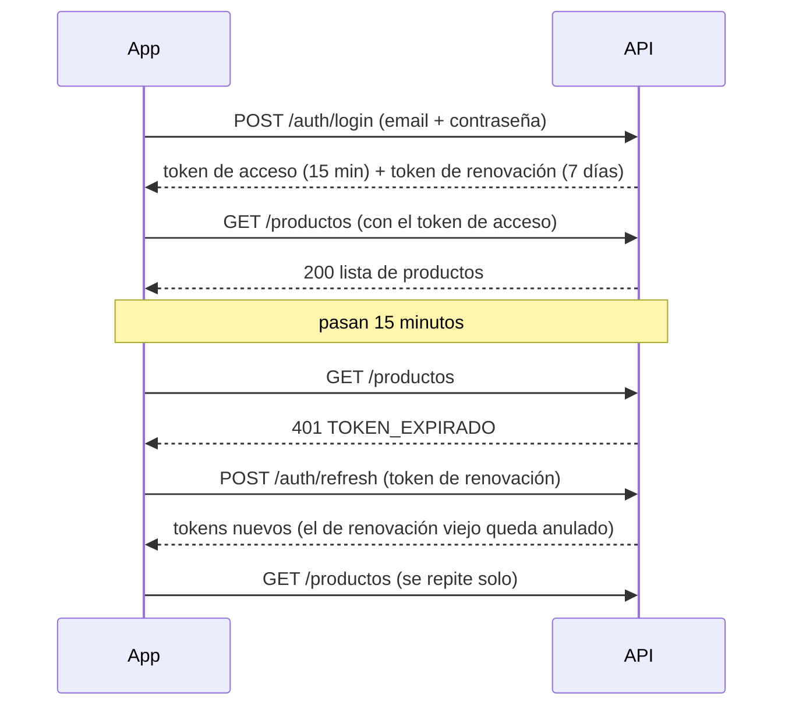

# Cómo está hecho BurgosCorp ERP

Este documento explica **qué se hizo, cómo funciona y en qué archivo está cada cosa**, en
lenguaje simple. Sirve para entender el proyecto, para estudiarlo antes de la defensa y para
encontrar rápido el código de cada parte.

> Se actualiza al terminar cada día del plan. Última actualización: **día 5**.

---

## 1. La idea en dos párrafos

BurgosCorp S.A. es un taller industrial ficticio que repara, diseña y fabrica piezas con
impresión 3D, tornos, CNC, soldadura y herrería. El sistema es un **ERP al estilo SAP R/3**:
una sola aplicación con módulos para cada área de la empresa (Recursos Humanos, Ventas,
Producción, Inventario, Compras, Mantenimiento, Calidad y Finanzas) que comparten la misma base
de datos.

El centro del sistema son las **tareas**: un trabajo de un cliente se convierte en una orden de
trabajo, que se divide en operaciones (diseñar, tornear, soldar…), y cada operación se asigna a
un empleado con la habilidad necesaria y a una máquina disponible.

## 2. Las tres piezas

```
┌──────────────────────┐        HTTPS + JSON         ┌──────────────────────┐        SQL        ┌──────────────┐
│  App móvil           │  ─────────────────────────▶ │  API REST            │ ────────────────▶ │  MySQL       │
│  React Native (Expo) │  ◀───────────────────────── │  Node.js + Express   │ ◀──────────────── │  51 tablas   │
│  carpeta mobile/     │   token en "Authorization"  │  carpeta backend/    │                   │  backend/db/ │
└──────────────────────┘                             └──────────────────────┘                   └──────────────┘
```

| Pieza | Qué hace | Dónde está |
|---|---|---|
| App | Pantallas que usa el empleado en el celular | [`mobile/`](../mobile) |
| API | Recibe pedidos de la app, controla permisos y habla con la base | [`backend/`](../backend) |
| Base de datos | Guarda todo: usuarios, empleados, máquinas, stock… | [`backend/db/schema.sql`](../backend/db/schema.sql) |

---

## 3. La base de datos

**Archivo:** [`backend/db/schema.sql`](../backend/db/schema.sql), con las tablas separadas por
módulo y comentadas. Los datos iniciales (roles, áreas, máquinas, productos) están en
[`backend/db/seed.sql`](../backend/db/seed.sql). Los datos de prueba (30 empleados y 29
usuarios) los carga [`backend/scripts/seed.js`](../backend/scripts/seed.js).

Ideas clave:

- **La base también controla.** Tiene reglas propias (`CHECK`) que rechazan datos imposibles
  aunque la API tuviera un error: stock negativo, licencias con la fecha de fin antes que la de
  inicio, una factura de venta a un proveedor, alícuotas de IVA que no existen.
- **Nada se borra de verdad.** Clientes, productos o máquinas se *desactivan* (`activo = 0`),
  así no se pierde la historia.
- **Lo sensible nunca se guarda en claro.** Las contraseñas, los tokens y los códigos se guardan
  como hash (una huella que no se puede revertir), y el secreto del 2FA va cifrado.
- **Numeración tipo SAP.** La tabla `secuencias` genera números como `OT-2026-0001`.

| Módulo | Tablas principales |
|---|---|
| Seguridad | `usuarios`, `roles`, `permisos_rol`, `cuentas_sociales`, `refresh_tokens`, `codigos_verificacion`, `auditoria` |
| Organización | `areas`, `area_modulos`, `puestos` |
| RRHH | `empleados`, `habilidades`, `empleado_habilidades`, `asistencias`, `solicitudes_licencia`, `epp_entregas` |
| Ventas | `clientes`, `servicios`, `solicitudes`, `presupuestos`, `presupuesto_items` |
| Producción y Tareas | `centros_trabajo` (máquinas), `ordenes_trabajo`, `tareas`, `tarea_asignaciones`, `registros_horas`, `consumos_material` |
| Inventario y Compras | `productos`, `depositos`, `stock`, `movimientos_stock`, `proveedores`, `ordenes_compra` |
| Mantenimiento y Calidad | `planes_mantenimiento`, `ordenes_mantenimiento`, `inspecciones`, `inspeccion_mediciones` |
| Finanzas | `comprobantes`, `comprobante_items`, `pagos` |

---

## 4. La API (backend)

### 4.1 El recorrido de un pedido

Cuando la app pide, por ejemplo, la lista de máquinas (`GET /api/v1/centros-trabajo`), el pedido
pasa por una serie de "filtros" (middlewares) en orden. Si alguno falla, el pedido se corta ahí
y se responde con un error claro.

| # | Paso | Qué controla | Archivo |
|---|---|---|---|
| 1 | Cabeceras de seguridad | Agrega protecciones estándar a cada respuesta | [`middlewares/seguridad.js`](../backend/src/middlewares/seguridad.js) |
| 2 | CORS | Solo acepta navegadores de orígenes conocidos | mismo archivo |
| 3 | Límite de pedidos | Frena a quien manda demasiados pedidos seguidos | [`middlewares/limites.js`](../backend/src/middlewares/limites.js) |
| 4 | Formato | El cuerpo tiene que ser JSON y pesar menos de 100 KB | [`app.js`](../backend/src/app.js) |
| 5 | ¿Quién sos? | Lee el token y carga el usuario desde la base | [`middlewares/auth.js`](../backend/src/middlewares/auth.js) |
| 6 | ¿Email verificado? | Sin verificar, no se entra a los módulos | mismo archivo |
| 7 | ¿Tenés permiso? | Rol, módulo, acción y área | [`middlewares/permisos.js`](../backend/src/middlewares/permisos.js) |
| 8 | ¿Los datos son válidos? | Tipos, largos y formatos de cada campo | [`middlewares/validar.js`](../backend/src/middlewares/validar.js) |
| 9 | Trabajo real | Consulta la base filtrando por tu alcance | [`utils/crud.js`](../backend/src/utils/crud.js) |
| 10 | Errores | Convierte cualquier error en un mensaje claro | [`middlewares/errores.js`](../backend/src/middlewares/errores.js) |

El servidor arranca en [`src/server.js`](../backend/src/server.js) y las rutas se juntan en
[`src/routes/index.js`](../backend/src/routes/index.js).

### 4.2 Iniciar sesión y mantenerla

**Archivos:** [`services/auth.js`](../backend/src/services/auth.js) (registro y login),
[`services/tokens.js`](../backend/src/services/tokens.js) (tokens),
[`routes/auth.js`](../backend/src/routes/auth.js) (endpoints).

Se usan **dos tokens**, como una pulsera y un ticket:

- **Token de acceso** (la pulsera): dura **15 minutos** y viaja en cada pedido. Si alguien lo
  roba, le sirve muy poco tiempo.
- **Token de renovación** (el ticket): dura **7 días** y sirve solo para conseguir una pulsera
  nueva. **Cada vez que se usa, se cambia por otro.** Si alguien intenta usar un ticket viejo
  (señal de que lo robaron), se cancelan todas las sesiones de ese dispositivo.



Otras protecciones del login:

- Las contraseñas se guardan con **bcrypt**, un hash lento a propósito para que adivinarlas sea
  muy caro.
- Después de **5 intentos fallidos**, la cuenta se bloquea 15 minutos.
- Si el email no existe, la respuesta es la misma que con una contraseña incorrecta, para no
  revelar quién tiene cuenta.

### 4.3 Otras formas de verificar (requisito de la consigna)

| Qué | Cómo funciona | Archivo |
|---|---|---|
| **Verificar email** | Al registrarse llega un código de 6 dígitos; hasta confirmarlo solo se puede usar la parte de login | [`services/verificacion.js`](../backend/src/services/verificacion.js) |
| **Recuperar contraseña** | Se pide un código por email y con él se define una contraseña nueva | mismo archivo |
| **Verificación en dos pasos (2FA)** | Además de la contraseña, un código de una app autenticadora (Google Authenticator), uno por email o uno de respaldo | [`services/dosPasos.js`](../backend/src/services/dosPasos.js) y [`services/totp.js`](../backend/src/services/totp.js) |
| Códigos de un solo uso | Vencen en 10 minutos, admiten 5 intentos, se guardan como hash | [`services/codigos.js`](../backend/src/services/codigos.js) |
| Envío de correos | En desarrollo se muestran en la consola; en producción salen por SMTP | [`services/email.js`](../backend/src/services/email.js) |

**Cómo funciona el código de la app autenticadora:** al activarlo, el servidor y el celular
comparten una clave secreta (la que va en el QR). Cada 30 segundos, los dos calculan el mismo
número de 6 dígitos a partir de esa clave y de la hora. Si coinciden, sos vos. El servidor
recuerda el último código usado para que no se pueda usar dos veces.

### 4.4 Login con Google, GitHub y Facebook

**Archivo:** [`services/social.js`](../backend/src/services/social.js). La guía para crear las
apps en cada proveedor está en [`docs/guia-oauth.md`](guia-oauth.md).

La app abre la pantalla de Google (o GitHub, o Facebook), el usuario acepta y la app le pasa a la
API lo que recibió. **La API no confía en eso:** lo verifica directamente con el proveedor.

- **Google:** comprueba la firma digital del token con las claves públicas de Google, y que el
  token sea para *esta* app y no haya vencido.
- **GitHub:** canjea el código con GitHub usando un secreto que solo conoce el servidor.
- **Facebook:** le pregunta a Facebook si el token es válido y si fue emitido para *esta* app.

Si el email de esa cuenta coincide con un empleado ya cargado, se vinculan: el empleado entra
con su Google y conserva su rol y su área.

> Estado: el código del servidor está hecho y probado con proveedores simulados. Falta crear las
> apps en cada proveedor y agregar los botones en la app.

### 4.5 Roles y permisos

**Archivos:** [`services/permisos.js`](../backend/src/services/permisos.js) (la lógica) y la
tabla `permisos_rol` en [`seed.sql`](../backend/db/seed.sql) (la matriz).

Hay 4 roles: **Administrador**, **Gerencia**, **Jefe de área** y **Empleado**. Cada permiso se
decide con tres preguntas:

1. **¿Qué rol tenés y qué querés hacer en qué módulo?** Por ejemplo, Empleado + crear + Inventario.
2. **¿Tu área administra ese módulo?** Algunos módulos son del área dueña: solo Abastecimiento
   carga productos y órdenes de compra, y solo Administración ve Finanzas.
3. **¿Sobre qué registros?** El **alcance**: `todo` (toda la empresa), `area` (tu área) o
   `propio` (solo lo tuyo).

Ejemplos reales, probados:

| Usuario | Ve | No ve |
|---|---|---|
| Jorge, jefe de Mecanizado | 18 máquinas de todas las áreas (su área administra Producción) | Ventas, Finanzas, Usuarios |
| Ramón, tornero | Solo las 7 máquinas de Mecanizado | Proveedores, Ventas, Finanzas |
| Ricardo, gerente | Todo | No puede modificar nada |

**Importante:** la app oculta los botones que no corresponden, pero **quien decide siempre es la
API**. Aunque alguien modificara la app, la API rechaza lo que no tiene permitido y lo registra en
la tabla `auditoria`.

### 4.6 El motor CRUD (lo que acelera el desarrollo)

**Archivo:** [`utils/crud.js`](../backend/src/utils/crud.js).

En vez de programar listar, ver, crear, editar y borrar para cada tabla, hay un "motor" al que se
le pasa una configuración y arma los 5 endpoints con paginación, búsqueda, filtros, orden,
permisos, alcance y auditoría. Por ejemplo, los clientes se configuran en
[`routes/catalogos.js`](../backend/src/routes/catalogos.js) en unas 10 líneas.

Por seguridad, los nombres de columnas, filtros y órdenes solo pueden ser los que dice la
configuración, y los valores que manda el usuario siempre van como parámetros. Eso hace
imposible la **inyección SQL**.

### 4.7 Recursos Humanos (día 5)

**Archivos:** [`routes/rrhh.js`](../backend/src/routes/rrhh.js) (endpoints),
[`services/licencias.js`](../backend/src/services/licencias.js),
[`services/asistencias.js`](../backend/src/services/asistencias.js),
[`services/notificaciones.js`](../backend/src/services/notificaciones.js) y
[`validators/rrhh.js`](../backend/src/validators/rrhh.js).

- **Legajos:** cada persona ve según su rol. Un empleado ve solo el suyo, un jefe los de su área
  y RRHH todos. Fuera de RRHH, lo único que se puede cambiar es el teléfono y la dirección
  propios. Así nadie puede subirse el sueldo o cambiarse de área. Los legajos no se borran: se
  dan de baja.
- **Habilidades:** cada empleado tiene sus habilidades con un nivel. Las que requieren
  certificación (soldadura MIG/TIG, trabajo en altura) guardan la fecha de vencimiento, y el
  sistema marca las vencidas. En el día 6 esto se usa para que **no se pueda asignar una tarea
  de soldadura a quien no está certificado**.
- **Fichaje:** botón de entrada y salida en Inicio. No se puede fichar dos veces la entrada, y
  RRHH puede corregir un olvido dejando el motivo registrado.
- **Licencias con circuito de aprobación**, igual que en SAP:

```
Empleado pide ──▶ Pendiente ──(jefe de su área)──▶ Aprobada por el jefe ──(RRHH)──▶ Aprobada
                      └──────────── Rechazada (con motivo) / Cancelada ─────────────┘
```

  Se cuentan solo los días hábiles, no se permiten pedidos superpuestos, nadie aprueba lo suyo y,
  si dos personas intentan resolver la misma solicitud a la vez, solo una lo logra.
- **Avisos:** cada paso le avisa a quien tiene que actuar ("Ramón pidió vacaciones", "Aprobaron
  tu solicitud").
- **Organigrama:** las áreas con su jefe y la cantidad de personas.

### 4.8 Validación de datos

**Archivos:** [`validators/`](../backend/src/validators). Cada campo tiene reglas (tipo, largo
igual al de la base, formato). Por ejemplo, el CUIT se valida con su dígito verificador y se
rechazan los campos de más: nadie puede mandar `"rol": "ADMIN"` al registrarse.

---

## 5. La app (mobile)

### 5.1 Cómo está organizada

Con **Expo Router**, cada archivo dentro de [`mobile/src/app/`](../mobile/src/app) es una
pantalla, y la carpeta determina la ruta.

| Pantalla | Archivo |
|---|---|
| Login | [`(auth)/login.js`](../mobile/src/app/(auth)/login.js) |
| Registro | [`(auth)/registro.js`](../mobile/src/app/(auth)/registro.js) |
| Olvidé / nueva contraseña | [`(auth)/olvide.js`](../mobile/src/app/(auth)/olvide.js), [`(auth)/restablecer.js`](../mobile/src/app/(auth)/restablecer.js) |
| Segundo paso del login | [`dos-pasos.js`](../mobile/src/app/dos-pasos.js) |
| Confirmar email | [`verificar-email.js`](../mobile/src/app/verificar-email.js) |
| Inicio | [`(app)/index.js`](../mobile/src/app/(app)/index.js) |
| Módulos | [`(app)/modulos/`](../mobile/src/app/(app)/modulos) |
| Listado de cualquier recurso | [`(app)/modulos/[modulo]/[recurso].js`](../mobile/src/app/(app)/modulos/[modulo]/[recurso].js) |
| Perfil, 2FA y avisos | [`(app)/perfil/`](../mobile/src/app/(app)/perfil) |
| Mis licencias (pedir y cancelar) | [`(app)/modulos/rrhh/licencias.js`](../mobile/src/app/(app)/modulos/rrhh/licencias.js) |
| Aprobar licencias (jefes y RRHH) | [`(app)/modulos/rrhh/aprobaciones.js`](../mobile/src/app/(app)/modulos/rrhh/aprobaciones.js) |
| Legajo (datos, habilidades, contacto) | [`(app)/modulos/rrhh/legajo/[id].js`](../mobile/src/app/(app)/modulos/rrhh/legajo/[id].js) |
| Organigrama | [`(app)/modulos/rrhh/organigrama.js`](../mobile/src/app/(app)/modulos/rrhh/organigrama.js) |
| Tarjeta de fichaje (en Inicio) | [`componentes/Fichaje.js`](../mobile/src/componentes/Fichaje.js) |

### 5.2 Qué pantalla se muestra (rutas protegidas)

**Archivo:** [`mobile/src/app/_layout.js`](../mobile/src/app/_layout.js). Según el estado de la
sesión, solo se puede ver un grupo de pantallas:

```
¿Hay sesión? ── no ──▶ ¿El login pidió el segundo paso? ── sí ──▶ Pantalla de 2FA
     │                                  └────────────── no ──▶ Login / Registro
     └── sí ──▶ ¿Email verificado? ── no ──▶ Confirmar email
                         └────────── sí ──▶ La app (pestañas)
```

### 5.3 Estado global y sesión que no se pierde

**Archivo:** [`mobile/src/contexto/sesion.js`](../mobile/src/contexto/sesion.js), con **Context
API + useReducer**, como pide la consigna. Guarda el usuario, sus permisos y el paso de 2FA
pendiente, y expone las acciones `login`, `registrar`, `completar2fa`, `logout`, etc.

- El token de renovación se guarda en **SecureStore**
  ([`lib/almacen.js`](../mobile/src/lib/almacen.js)), que en Android usa el almacén cifrado del
  sistema. Al abrir la app, la sesión se recupera sola.
- El cliente de la API ([`lib/api.js`](../mobile/src/lib/api.js)) agrega el token a cada pedido.
  Si el token venció, lo renueva y repite el pedido sin que el usuario se entere. También
  traduce cualquier error a un mensaje en castellano: sin conexión, tiempo agotado, sin permiso…

### 5.4 Identidad visual (igual al portal R3) y diseño adaptable

La app copia la identidad del portal BurgosCorp R3 (`C:\Estanga\React\R3 V`): la misma paleta,
el mismo logo, las mismas animaciones y la misma forma de avisar, sin alertas.

| Qué | Cómo | Archivo |
|---|---|---|
| Paleta | Los mismos tokens de R3: rojo `#c8102e` (`#ef3b4f` en oscuro), negro `#111` y grises zinc | [`tema.js`](../mobile/src/tema.js) |
| Logo | El escudo negro con borde rojo y "BC" en serif (`BrandLogo` / `ShieldSeal` de R3), dibujado con SVG; "Burgos**Corp**" en Georgia | [`componentes/Marca.js`](../mobile/src/componentes/Marca.js) |
| Intro de apertura | Pantalla negra con resplandor rojo, el escudo aparece y "BurgosCorp" se escribe letra por letra (una vez por apertura; se saltea tocando) | [`componentes/IntroSplash.js`](../mobile/src/componentes/IntroSplash.js) |
| Login | Panel de marca (en pantallas anchas) + formulario; "Recordar mi email"; el botón pasa a "Verificando credenciales…" y, si son válidas, el escudo se sella y aparece "Acceso verificado" | [`componentes/AuthLayout.js`](../mobile/src/componentes/AuthLayout.js), [`(auth)/login.js`](../mobile/src/app/(auth)/login.js) |
| Barra y pestañas | Negras en los dos modos; pestaña activa en blanco con línea roja; a la derecha, luna/sol y avatar | [`(app)/_layout.js`](../mobile/src/app/(app)/_layout.js) |
| Sin alertas | Los resultados se informan con **toasts** abajo (verde, rojo, amarillo o negro), las confirmaciones usan un **diálogo propio** y los errores de un campo aparecen debajo del campo | [`contexto/toast.js`](../mobile/src/contexto/toast.js), [`componentes/ConfirmDialog.js`](../mobile/src/componentes/ConfirmDialog.js) |
| Componentes | Botones y campos estilo Bootstrap, tarjetas con cabecera, insignias de rol (admin rojo suave, jefe negro, empleado gris), avatares con iniciales, esqueletos de carga, contadores animados, requisitos de contraseña que se tildan | [`componentes/ui.js`](../mobile/src/componentes/ui.js), [`lib/useContador.js`](../mobile/src/lib/useContador.js) |
| Modo claro / oscuro | Sistema, Claro u Oscuro en Perfil, o luna/sol en la barra y el login; queda guardado en el dispositivo (dato no sensible) | [`componentes/SelectorTema.js`](../mobile/src/componentes/SelectorTema.js), [`lib/preferencias.js`](../mobile/src/lib/preferencias.js) |

Con "reducir movimiento" activado en el sistema, las animaciones no se reproducen.

- Las grillas pasan de 2 a 4 columnas según el ancho, y los listados usan 2 columnas en tablet o
  en horizontal.
- Los formularios tienen un ancho máximo para que no queden estirados en pantallas grandes.
- La app gira a horizontal.

### 5.5 Qué muestra cada rol

[`mobile/src/modulos.js`](../mobile/src/modulos.js) es el catálogo de módulos y define cómo se
muestra cada recurso: título, detalle y etiquetas como "Bajo mínimo" o "En mantenimiento". La
pestaña Módulos muestra solo los que el rol puede ver, según lo que responde `/auth/yo`.

---

## 6. Seguridad (OWASP), resumen

| Riesgo | Qué se hizo | Dónde |
|---|---|---|
| Acceso indebido (A01) | Permisos por rol, módulo, acción y área en cada pedido | `services/permisos.js` |
| Mala configuración (A02) | Cabeceras de seguridad, CORS cerrado, `.env` fuera del repo | `middlewares/seguridad.js`, `.gitignore` |
| Robo de contraseñas o sesión (A07) | bcrypt, bloqueo por intentos, tokens cortos y rotativos, 2FA | `services/auth.js`, `tokens.js`, `dosPasos.js` |
| Inyección SQL (A05) | Consultas con parámetros y columnas en lista blanca | `utils/crud.js` |
| Abuso de recursos (A06) | Límite de pedidos y de tamaño, timeouts | `middlewares/limites.js`, `server.js` |
| Falta de registros (A09) | Tabla `auditoria`: logins, bloqueos, accesos denegados | `services/auditoria.js` |
| Errores que revelan datos (A10) | Mensajes genéricos al usuario; el detalle queda solo en el servidor | `middlewares/errores.js` |
| Datos en el celular | Tokens en SecureStore, sin copias de seguridad, sin permisos de Android | `mobile/src/lib/almacen.js`, `mobile/app.json` |

La skill y el agente que revisan esto durante el desarrollo están en
[`.claude/skills/seguridad-owasp/`](../.claude/skills/seguridad-owasp) y
[`.claude/agents/revisor-owasp.md`](../.claude/agents/revisor-owasp.md).

---

## 7. Cómo se prueba

| Qué | Cómo | Dónde |
|---|---|---|
| API | 65 tests automáticos: login, tokens, permisos, 2FA, códigos, redes sociales simuladas, inyección SQL, legajos, fichaje y el circuito de licencias | [`backend/tests/`](../backend/tests) |
| App | Probada en el navegador, con tamaño de celular y de escritorio, con usuarios de distintos roles | — |

Para correr los tests: `cd backend && npm test` (con una base de prueba, porque modifican datos).

---

## 8. Avance por día

| Día | Qué | Estado |
|---|---|---|
| 1 | Estructura del repo y base de datos | ✅ |
| 2 | API: login, tokens, permisos, motor CRUD | ✅ |
| 3 | 2FA, códigos por email, login social en el servidor | ✅ (faltan las credenciales de Google, GitHub y Facebook) |
| 4 | App: sesión, login, navegación por rol | ✅ |
| 5 | Organización y RRHH | ✅ |
| 6 | Producción y Tareas | ⏳ |
| 7 | Inventario y Compras | ⏳ |
| 8 | Ventas, Finanzas y Tablero | ⏳ |
| 9 | Publicar la API, generar el APK, auditoría de seguridad | ⏳ |
| 10 | Manual de usuario y documentación final | ⏳ |
